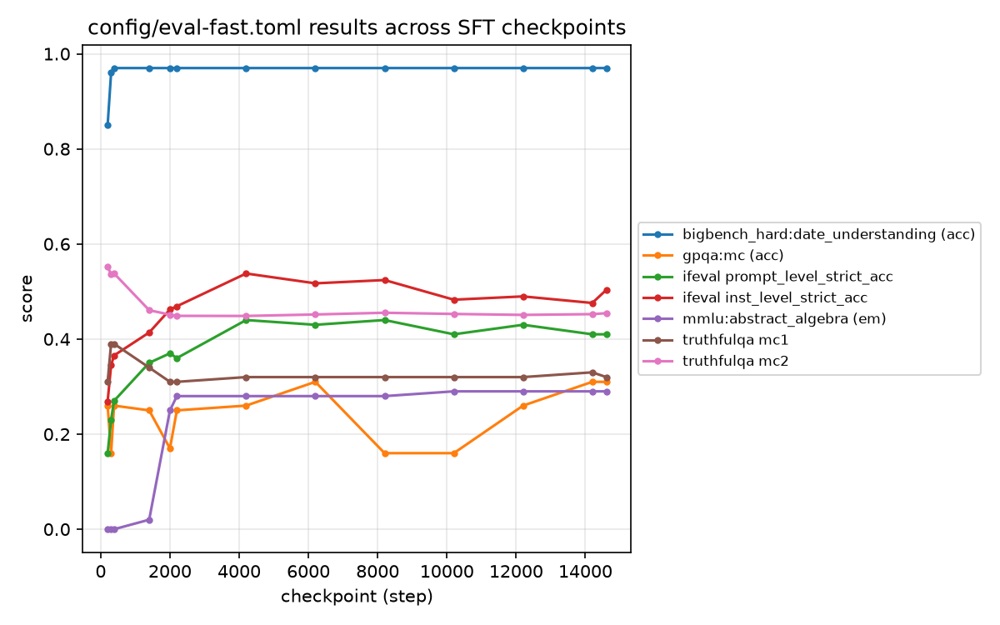

# posttrain

Taking `Qwen/Qwen3-1.7B-Base` through a full post-training pipeline on a DGX Spark, and
comparing the result against Qwen's own post-trained `Qwen/Qwen3-1.7B`. That comparison is
the point: it measures how close an open recipe gets to Qwen's own.

Stage one — supervised finetuning on the Tulu 3 SFT mixture. Preference
tuning and RL come later.

## Setup

    uv sync

That is all that is needed on either machine. The Spark's GB10 is Blackwell (sm_121) and
needs a CUDA 13 build of PyTorch, so `pyproject.toml` routes torch to the `cu130` index on
Linux and leaves macOS on the stock PyPI wheel for its MPS build. `uv sync` picks the right
one from the platform.

## Running SFT

Three configs, in the order they are meant to be used. First prove the pipeline runs end to
end on 64 examples:

    uv run posttrain sft --config config/smoke.toml

Then a 50k-example pilot, which is the one that tells you what the full run will cost —
divide its throughput into 939k examples times two epochs before committing to it:

    uv run posttrain sft --config config/pilot.toml

Then the real run:

    uv run posttrain sft

Any config key can be overridden from the command line, which keeps one-off experiments out
of version control:

    uv run posttrain sft -s lr=1e-5 -s n=50000

## Resuming

The full run spans days, so `posttrain sft` picks up from the newest checkpoint in
`out_dir` automatically — rerun the same command after an interruption. Use
`-s resume=false` to start over instead.

It resumes from the newest *complete* checkpoint, not simply the newest. A run killed
mid-save — spot preemption, a power cut — leaves a directory with the highest step number
and truncated files inside, so resuming blindly would load a broken checkpoint. Each
candidate is checked for its resume files, a parseable `trainer_state.json`, and weights
whose safetensors header agrees with the file size; the first one that passes wins, and
skipped ones are named on stdout.

Weights, optimizer, and scheduler resume exactly. Data ordering does not: the
length-grouped sampler draws from the global RNG, and a resumed run restores RNG state
from mid-epoch rather than from where the shuffle happened, so the remainder of that
epoch is regrouped. Some examples repeat and others are skipped within it — negligible
over 939k rows, but it means a resumed run is not bit-identical to an uninterrupted one.

## Running on GCP Batch

The Spark is the primary machine; Batch is for when it is busy, or to prove a run can
happen somewhere else. Building the image, submitting a job, and what needs a rebuild are
covered in [docs/gcp-batch.md](docs/gcp-batch.md).

## Checkpoints

Every checkpoint is kept (`save_total_limit` unset). They are not small: weights are only
3.4GB of the ~17.2GB, the rest being fp32 Adam state, which is what makes a resume exact.

Only the two newest carry optimizer state — `keep_optimizer_states`, pruned after each save.
Older checkpoints keep their weights and stay loadable by `posttrain chat`; they just can't
be resumed from, which nothing needs. Two rather than one because a crash mid-write can
leave the newest unusable.

| `save_steps` | Checkpoints | Disk kept all | Disk pruned | Interval |
| -----------: | ----------: | ------------: | ----------: | -------: |
| **200**      | **73**      | 1.26 TB       | **0.28 TB** | **3.5 h** |
| 500          | 29          | 0.50 TB       | 0.13 TB     | 8.7 h    |
| 1000         | 14          | 0.24 TB       | 0.08 TB     | 17.4 h   |
| 2000         | 7           | 0.12 TB       | 0.05 TB     | 34.8 h   |

The default is 200, which pruning makes affordable: 0.28 TB for the full run, and an
interruption costs at most 3.5 hours. Raise it if disk is tight. Set
`-s keep_optimizer_states=0` to strip them all, giving up resume entirely.

## Verifying before a long run

    uv run posttrain check

This builds the real trainer, pulls the first batch, and decodes exactly which tokens carry
loss — printing the trained text and exiting non-zero if nothing is trained on, if user
turns leak into the loss, or if the stop token is masked out. Worth running before any
multi-hour job, since a broken mask does not raise on its own.

## Sampling from a checkpoint

    uv run posttrain chat runs/pilot
    uv run posttrain chat runs/pilot -p "Explain backprop to a physicist."

Falling loss and a usable chat model are different claims, and only the second is what the
comparison against Qwen's post-train is about. Point it at `Qwen/Qwen3-1.7B` to sample the
target for the same prompts.

Generation primes the assistant turn with an empty `<think>` block, matching how the recipe
formats its training data.

## Benchmarks

Evaluation is a separate step so it never competes with training for the GPU. It needs an
extra install, since lighteval pulls in `inspect-ai` and a large task surface:

    uv sync --extra eval
    uv run posttrain eval

That benchmarks every checkpoint plus `Qwen/Qwen3-1.7B`, then prints a table of every
score side by side. Which checkpoints and which tasks are config:

    uv run posttrain eval --config config/eval-fast.toml   # quick subset, see below
    uv run posttrain eval -s stride=2                      # every other checkpoint
    uv run posttrain eval -s checkpoints=runs/pilot/checkpoint-300
    uv run posttrain eval -s "tasks=ifeval|0"              # quote: | is a shell pipe

| Task              | Measures                              |
| ----------------- | ------------------------------------- |
| `ifeval`          | Instruction following — most sensitive to SFT quality |
| `gsm8k`           | Grade-school math                     |
| `mmlu`            | Knowledge, all 57 subjects            |
| `bigbench_hard`   | Multi-step reasoning, 27 subtasks     |
| `truthfulqa:mc`   | Factuality                            |
| `math_500`        | Competition math                      |
| `gpqa:diamond`    | Graduate-level science                |

The number after the pipe is the few-shot count. `stride` thins the sweep when a run keeps
more checkpoints than are worth benchmarking — the newest checkpoint is always included
whatever the stride, and passing a directory with no `checkpoint-*` subdirectories
evaluates it directly.

### The fast subset

`config/eval-fast.toml` is minutes rather than hours, for checking the harness works and for
iterating. It avoids the two things that make the full suite slow:

| Full suite      | Fast subset                           | Why                                    |
| --------------- | ------------------------------------- | -------------------------------------- |
| `math_500`, `gpqa:diamond` | dropped, `gpqa:mc` instead | Those cap generation at 32768 tokens, sized for reasoning models. `gpqa:mc` generates 1. |
| `mmlu` (14,042) | `mmlu:abstract_algebra`               | One subject instead of 57              |
| `bigbench_hard` (27 subtasks) | `bigbench_hard:date_understanding` | One subtask instead of 27 |
| —               | `truthfulqa:mc`                       | Kept: loglikelihood only, generates nothing |
| —               | `ifeval`                              | Kept: the signal most sensitive to SFT quality |

It also sets `max_samples = 100` and `baseline = "none"`. Turn the baseline back on once the
harness is known to work — `"none"` is how a TOML file expresses null here.

The 32768-token caps are worth understanding before running the full suite. If a checkpoint
does not reliably emit `<|im_end|>`, those tasks generate to the cap on every sample and a
ten-minute task becomes an all-day one.

### Fast-subset results

A `config/eval-fast.toml` sweep across the SFT run's checkpoints:

| checkpoint | bbh_date | gpqa | ifeval_prompt_str | ifeval_inst_str | ifeval_prompt_loose | ifeval_inst_loose | mmlu_algebra | tqa_mc1 | tqa_mc2 |
|-----------:|---------:|-----:|-------------------:|-----------------:|---------------------:|---------------------:|-------------:|--------:|--------:|
| 200        | 0.8500   | 0.2600 | 0.1600            | 0.2690           | 0.1900               | 0.3034               | 0.0000       | 0.3100  | 0.5525  |
| 300        | 0.9600   | 0.1600 | 0.2300            | 0.3448           | 0.2900               | 0.4000               | 0.0000       | 0.3900  | 0.5358  |
| 385        | 0.9700   | 0.2600 | 0.2700            | 0.3655           | 0.3300               | 0.4138               | 0.0000       | 0.3900  | 0.5381  |
| 1400       | 0.9700   | 0.2500 | 0.3500            | 0.4138           | 0.3700               | 0.4414               | 0.0200       | 0.3400  | 0.4607  |
| 2000       | 0.9700   | 0.1700 | 0.3700            | 0.4621           | 0.3900               | 0.4759               | 0.2500       | 0.3100  | 0.4513  |
| 2200       | 0.9700   | 0.2500 | 0.3600            | 0.4690           | 0.3900               | 0.4897               | 0.2800       | 0.3100  | 0.4488  |
| 4200       | 0.9700   | 0.2600 | 0.4400            | 0.5379           | 0.4500               | 0.5448               | 0.2800       | 0.3200  | 0.4486  |
| 6200       | 0.9700   | 0.3100 | 0.4300            | 0.5172           | 0.4600               | 0.5379               | 0.2800       | 0.3200  | 0.4517  |
| 8200       | 0.9700   | 0.1600 | 0.4400            | 0.5241           | 0.4600               | 0.5379               | 0.2800       | 0.3200  | 0.4553  |
| 10200      | 0.9700   | 0.1600 | 0.4100            | 0.4828           | 0.4300               | 0.4966               | 0.2900       | 0.3200  | 0.4528  |
| 12200      | 0.9700   | 0.2600 | 0.4300            | 0.4897           | 0.4500               | 0.5103               | 0.2900       | 0.3200  | 0.4508  |
| 14200      | 0.9700   | 0.3100 | 0.4100            | 0.4759           | 0.4400               | 0.5034               | 0.2900       | 0.3300  | 0.4524  |
| 14604      | 0.9700   | 0.3100 | 0.4100            | 0.5034           | 0.4500               | 0.5379               | 0.2900       | 0.3200  | 0.4544  |

`ifeval` climbs steadily with training; `mmlu:abstract_algebra` jumps from 0 to ~0.29 within
the first ~2k steps and then plateaus; `truthfulqa` mc1/mc2 both drift down slightly over the
run rather than improving.

## Tracking

Runs log to Weights & Biases when `wandb_project` is set, which `config/sft.toml` does and
`config/smoke.toml` deliberately does not. Log in once per machine:

    uv run wandb login

To train without it, clear the key:

    uv run posttrain sft -s wandb_project=none

`posttrain check` never logs, whatever the config says — a pre-flight check shouldn't leave
runs behind.

## Configs

Recipes live in `config/` as TOML and are read into `SftConfig` (`src/posttrain/config.py`),
which is the single source of truth for the schema — unknown keys in either the file or a
`--set` override are an error rather than a silent no-op.

| Config              | Purpose                                                            |
| ------------------- | ------------------------------------------------------------------ |
| `config/smoke.toml` | 64 examples, short sequences — a correctness check, not a run.      |
| `config/pilot.toml` | 50k examples, 1 epoch — a real loss curve and a throughput number.  |
| `config/sft.toml`   | The Tulu 3 recipe: 2 epochs, lr 5e-6, effective batch 128.          |

## Startup

Tokenizing, truncating, and filtering 939k rows happens before step one and is
single-threaded by default. `dataset_num_proc` parallelises it and defaults to every core;
set it explicitly to cap that:

    uv run posttrain sft -s dataset_num_proc=8

`datasets` caches the result, so a second run on the same machine skips the work entirely —
this is a first-run and after-a-config-change cost, not a per-run one.

## Throughput

Batches pad to the longest example in them, and the Tulu mixture is wildly uneven — most
examples are a few hundred tokens against a 4096 limit. `group_by_length` (on by default)
batches similar lengths together so that padding stays tight. It costs one pass over the
tokenized dataset at startup to measure lengths, and it groups at effective-batch
granularity, shuffling megabatches so the ordering stays random enough.

Packing would be the stronger fix, but it isn't available here: TRL's default `bfd` strategy
forces padding-free batching, which needs FlashAttention 2/3 kernels with no aarch64 build,
and the alternative `wrapped` strategy cuts mid-sequence and would corrupt the assistant
mask. Grouping shrinks padding; only packing removes it.

    uv run posttrain sft -s group_by_length=false          # to compare
    uv run posttrain sft -s gradient_checkpointing=false   # ~30% faster if memory allows

Grouping has two side effects worth knowing. Training loss develops a sawtooth: megabatches
are sorted longest-first, so each one ends on short examples that carry few tokens and score
a worse per-token loss. Read `eval_loss` rather than training loss. Evaluation itself is
pinned to a fixed order regardless of this setting — otherwise the eval set would be
reshuffled on every call and `eval_loss`, which averages per batch, would drift on its own.

`batch_size * grad_accum` is the effective batch size; keep the product at 128 when trading
one against the other to fit memory.

## Chat template

The base checkpoint ships no usable chat format, so `clone_chat_template` copies Qwen3's
ChatML template across, switches the EOS token from `<|endoftext|>` to `<|im_end|>`, and
resizes the embeddings for the added tokens.

Loss is computed on assistant turns only (`assistant_only_loss=True`). This matters more
than it looks: Qwen3's published template has no `` markers, and asking for
assistant masks against it does not raise — it silently returns an all-zero mask, which
would train on no tokens at all. TRL patches the template itself when the markers are
missing, and warns if any example ends up with zero assistant tokens.

## Development

    uv run pytest
    uv run black . && uv run isort .

The tests cover config loading and CLI wiring only, and deliberately run without torch or
trl installed — `posttrain sft --help` defers the training imports so it stays fast.
